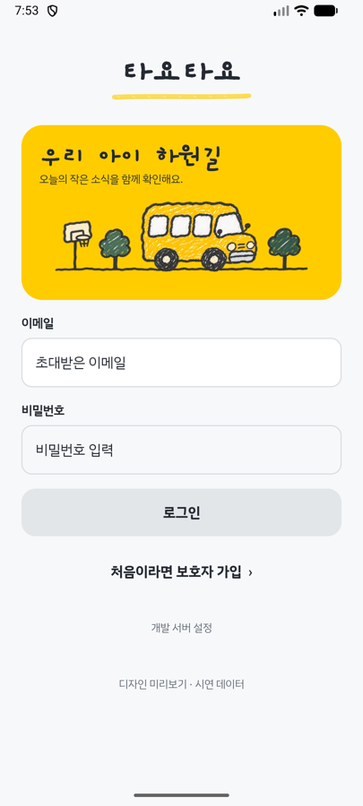
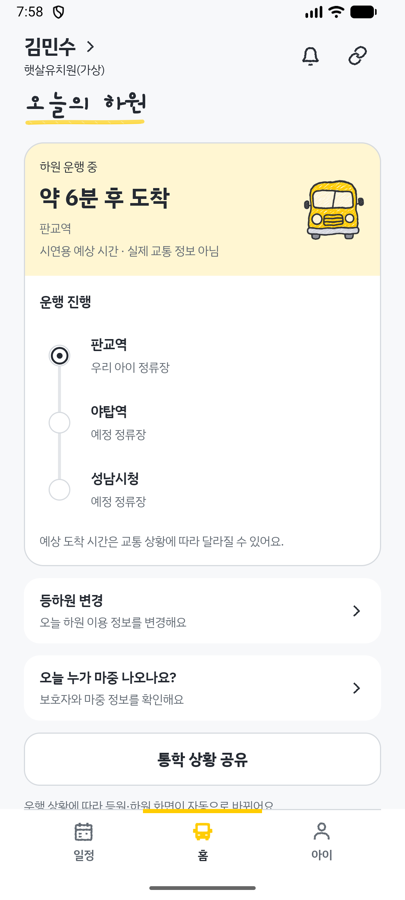
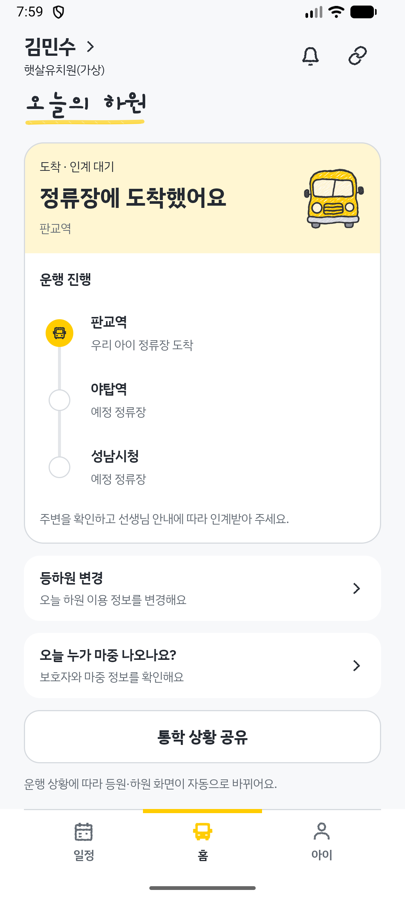
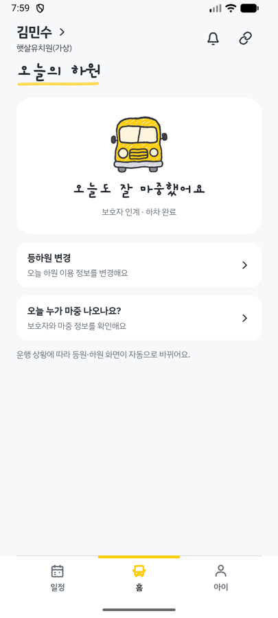
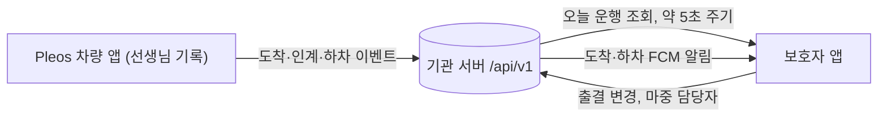

# 타요타요 보호자 앱

**통학 차량이 어디쯤 왔는지, 우리 아이가 누구에게 인계됐는지 보호자가 직접 확인하는 Android 앱입니다.**
Pleos 차량 앱에서 동승 선생님이 남긴 도착·인계·하차 기록을 같은 서버에서 받아 보여 줍니다.

| 로그인 | 하원 운행 중 | 정류장 도착 | 인계·하차 완료 |
| :---: | :---: | :---: | :---: |
|  |  |  |  |
| 기관에서 초대받은 이메일로 가입 | 남은 시간과 내 아이 정류장 | 선생님이 도착을 기록한 뒤 | 선생님이 인계·하차를 기록한 뒤 |

> 2026-11-15, Android 에뮬레이터에서 로컬 서버와 [Pleos 차량 앱](https://github.com/Hyundai-Mobility-Challenge/TayoTayo-vehicle)을 연결해 가상 아동 데이터로 찍은 화면입니다. 운행 중 화면의 예상 시간에는 앱이 "시연용 예상 시간 · 실제 교통 정보 아님"이라고 함께 표시합니다.

[타요타요 전체 소개](https://github.com/Hyundai-Mobility-Challenge/TayoTayo-vehicle) · [기관 서버](https://github.com/Hyundai-Mobility-Challenge/TayoTayo-server) · [제출용 APK 내려받기](https://github.com/Hyundai-Mobility-Challenge/TayoTayo-parent/releases/download/v0.2-invitations/parent-release.apk)

## 주요 기능

| 기능 | 보호자가 하는 일 |
| --- | --- |
| 아이 연결 | 기관이 발급한 어린이 초대 코드를 입력해 아이와 연결합니다. 초대받은 이메일 계정으로만 연결됩니다. |
| 오늘의 등하원 | 진행 중인 등원·하원 운행을 먼저 보여 줍니다. 출발 대기 → 이동 → 도착 → 인계·하차 순서로 화면이 바뀝니다. |
| 일정 변경 | 날짜별로 결석·직접 등하원을 알리고, 그날 마중 나갈 보호자를 지정합니다. 지난 날짜는 읽기만 할 수 있습니다. |
| 대리 보호자 | 함께 마중 나올 가족을 등록 신청하고 기관의 승인 상태를 확인합니다. |
| 알림 | 정류장 도착과 하차 때 푸시 알림을 받고, 알림을 누르면 해당 운행으로 이동합니다. |
| 통학 상황 공유 | 앱이 없는 가족에게 조회 전용 링크를 보냅니다. 아이가 하차하면 저장된 링크를 폐기합니다. |

아이 이름·반 같은 원아 정보는 기관 관리자 웹에서 관리하며, 보호자 앱에서는 수정하지 않습니다.

## 화면 구성

하단 탭은 **일정 · 홈 · 아이** 세 개입니다. 손글씨 워드마크와 크레용 일러스트, Gaegu·IBM Plex Sans KR 글꼴은 Figma 시안의 원본 자산을 앱에 포함했습니다.

- **홈**: 등하원 상태 카드, 오늘 변경, 마중 보호자 패널
- **일정**: 달력과 선택 날짜의 등원·하원 변경, 보호자 지정
- **아이**: 연결 정보, 대리 보호자 신청 상태, 알림·계정 설정

등원 운행이 끝나면 하원 화면으로 자동 전환합니다. 기관 운행 시간 정보가 없을 때는 한국 시간 정오를 전환 기준으로 사용합니다.

## 차량 앱·서버와의 관계



보호자 앱은 차량 앱과 직접 통신하지 않고 같은 서버만 사용합니다. 아이의 상태는 **선생님이 기록한 시점에만** 바뀝니다. 예상 시간이 0이 되거나 차량이 정류장 근처에 있어도 도착·하차로 처리하지 않습니다.

## 시작하기

### 1. 설치

- 제출용 release APK: [parent-release.apk](https://github.com/Hyundai-Mobility-Challenge/TayoTayo-parent/releases/download/v0.2-invitations/parent-release.apk) · [저장소 안 사본](apk/parent-release.apk)
- 직접 빌드: Android Studio에서 저장소 루트를 엽니다. Android SDK 36, JDK 17 이상이 필요하고 최소 API는 28입니다. Pleos SDK 없이 빌드됩니다.

```sh
./gradlew :parent:assembleDebug        # Windows: .\gradlew.bat
```

| 항목 | 값 |
| --- | --- |
| 앱 모듈 | `parent` |
| 앱 ID | `com.ssafy.tonghak.parent` |
| 디버그 APK | `parent/build/outputs/apk/debug/parent-debug.apk` |

release APK를 새로 배포하려면 `:parent:assembleRelease`로 빌드한 뒤 `parent/build/outputs/apk/release/parent-release.apk`를 `apk/parent-release.apk`로 복사합니다. 저장소의 `*.apk` 제외 규칙 때문에 새 APK는 Git에 자동으로 추가되지 않습니다.

### 2. 서버 연결과 아이 연결

1. [기관 서버](https://github.com/Hyundai-Mobility-Challenge/TayoTayo-server)를 실행하고 기관·차량·정류장·노선·원아 배정을 준비합니다.
2. 로그인 화면 아래 **개발 서버 설정**에서 서버 주소를 입력합니다. `/api/v1`은 앱이 자동으로 붙입니다.

   | 실행 환경 | 서버 주소 |
   | --- | --- |
   | Android 에뮬레이터 | `http://10.0.2.2:8080` |
   | 실제 휴대폰 (서버 PC와 같은 Wi-Fi) | `http://<서버 PC의 LAN IPv4>:8080` |

3. **처음이라면 보호자 가입**으로 가입합니다. 개발 서버는 이메일을 보내지 않고 인증번호를 응답 메시지에 표시합니다.
4. 기관이 해당 이메일로 발급한 **어린이 초대 코드**를 **초대 코드 연결**에 입력합니다. 차량 앱에 넣는 차량 페어링 코드와는 다른 코드입니다.
5. 알림 권한을 허용하면 푸시 등록이 끝납니다.

개발용 HTTP는 로컬 시연용입니다. 공개 운영 서버에는 HTTPS가 필요합니다. 세 저장소를 함께 연결하는 전체 순서는 [연결 안내](docs/INTEGRATION.md)에 있습니다.

### 3. 서버 없이 화면만 보기

debug 빌드의 로그인 화면 아래 **디자인 미리보기 · 시연 데이터**를 누르면 계정 없이 화면을 둘러볼 수 있습니다. 상단 버튼으로 하원 운행 → 등원 대기 → 하차 완료를 바꾸고, **호출 시연**으로 응답 패널을 확인합니다. 실제 계정·일정·알림은 바뀌지 않으며 release 빌드에는 포함되지 않습니다.

### 4. 푸시 알림 (Firebase)

Firebase에서 위 앱 ID로 받은 `google-services.json`을 `parent/google-services.json`에 두고 빌드합니다. 파일이 없어도 빌드와 일반 조회는 되지만 푸시는 꺼집니다. 서버도 같은 Firebase 프로젝트의 서비스 계정을 사용해야 하며, 두 파일 모두 Git에 올리지 않습니다.

## 구조

| 경로 | 역할 |
| --- | --- |
| `parent/` | Compose UI, 계정·초대, FCM, 운행 진행·공유, 출결·픽업 관리 |
| `common/kotlin/` | 서버 API 클라이언트 사본 |
| `common/web/` | 공유 링크 웹 렌더러 사본 |
| `scripts/test-*.cjs` | 렌더러 테스트 (Node.js 18 이상) |

## 검증과 남은 범위

- 단위 테스트 `JourneyDataTest`는 시간 단위, 등하원 자동 전환, 도착·하차·인계 구분을 확인합니다. UI 테스트 `MajungUiTest`는 탭 이동, 아이 선택, 날짜별 변경 패널, 지난 날짜 읽기 전용, 호출 응답 상태를 확인합니다.
- 렌더러 테스트: `node scripts/test-route-map.cjs`, `node scripts/test-stop-timeline.cjs`
- 실제 휴대폰의 FCM 수신은 Firebase 설정과 실행 중인 서버가 있어야 확인할 수 있습니다. 빌드 성공만으로 푸시 수신이 검증되지는 않습니다.
- 호출 응답 API와 기관별 변경 마감 정책은 서버 계약이 확정되지 않아 운영 연동을 마치지 않았습니다. 앱은 임의의 응답 성공이나 마감 시간을 만들어 표시하지 않습니다. 자세한 내용은 [구현 현황](docs/MVP_IMPLEMENTATION_STATUS.md)과 [시연 검토](docs/PARENT_DEMO_REVIEW.md)에 있습니다.

[분리 기준](docs/SOURCE_SNAPSHOT.md) · [분리 검증 결과](docs/SPLIT_VALIDATION.md) · [기능 테스트 보고](docs/IMPLEMENTED_FEATURE_TEST_REPORT.md)
